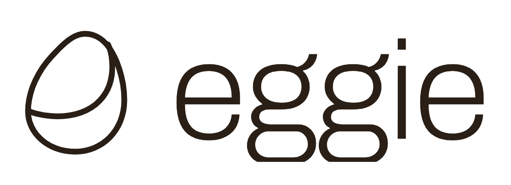

  

<b>Building an app should be as easy as boiling an egg.</b>

Eggie sets up a ready-to-cook development environment on your computer —
or in the cloud — so you can build real apps with your AI coding agent
without touching a terminal.

- 🍳 **One-click kitchen** — install once, everything inside just works
- 🧑‍🍳 **Bring your agent** — connect the coding agent you already use and start prompting
- 📦 **Projects, not configs** — start, stop, open in browser, upload files
- ☁️ **Eggie Cloud** — move your project to your own server when you're ready

### Get started
👉 [eggie.io](https://eggie.io) · 📚 [Docs](https://eggie.io/docs)

### Repositories
- [**eggie**](https://github.com/eggie-io/eggie) — the open-source runtime and desktop app

### Status
Open beta — feedback and issues are very welcome.
